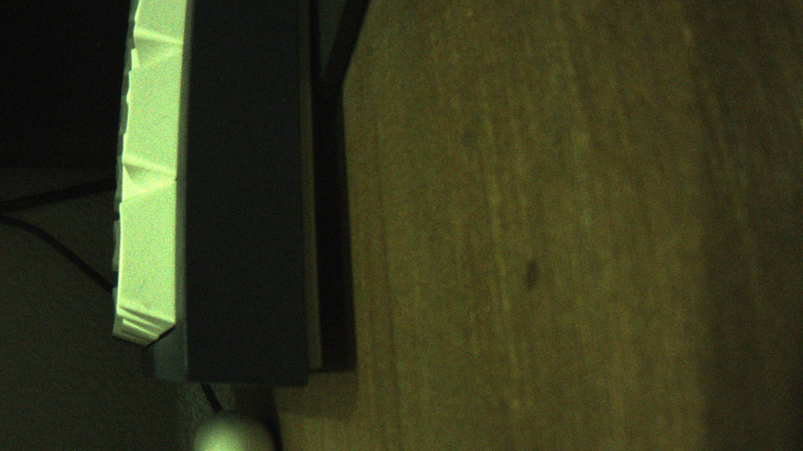

# 08 摄像头与 ToF

这两个外设都在上游 Microduck 的软件栈里: 摄像头走 `mediad` (WebRTC 视频), ToF 走 `tofd` (8x8 距离阵列)。本页写它们在 A733 + 本 HAT 上的适配方式。

物料:

| 项 | 器件 | 状态 |
|---|---|---|
| 摄像头 | IMX219 模组 (Raspberry Pi camera v2 兼容, 排线 CSI), 上游购物清单同款 160 度广角 | ✅ 抓帧实测通 (RG10 1920x1080), WebRTC 出流待 GStreamer |
| ToF | VL53L5CX (VL53L5X V2) 模组, I2C 地址 0x29, 接 HAT 的 H1 排针 | 未实测, 需板上验证 |

## 摄像头

### 结论: 驱动不用改, 板级补两样东西

A733 的原厂设备树 (`sun60i-a733-orangepi-zero3w.dtb`) 已经把 IMX219 配好并使能:

- `sensor0_mname = "imx219"`, `status = "okay"`, I2C 地址 0x10, MCLK 1
- `csi@5820000` / `mipi@5810100` / `vinc@5830000` 全部 `okay`

摄像头走的是主控板自带的 CSI 相机座和专用 CCI 控制器, 与 HAT 的 40 排针和 I2C3 (codec/ToF 共用) 无关。内核模块 `imx219.ko` / `vin_v4l2.ko` 在镜像里都有 (vendor 内核 `kernel/bsp/drivers/vin/`)。

**出图只需要两件事**, 都跟驱动源码无关:

1. **BLDO2 (VCC_3V3_CSI) 常开** — `hardware/overlay/csi-rail.dts` (已编好 dtbo)。
   板级 DTS 里没有任何 consumer 引用这颗 LDO, 开机约 30 秒的 unused-regulator
   sweep 会把它关掉。症状是「传感器 I2C 应答、格式能读, 但一帧不进来、中断恒 0」。
   Armbian 有一份等价补丁 (`0008-orangepizero3w-keep-csi-camera-rail-always-on.patch`,
   只给 `reg_bldo2` 加 `regulator-always-on`), 我们跑的内核没带, 所以用 overlay 补。
2. **`vin_v4l2` 开机自动加载** — `modules-load.d/vin_v4l2.conf`。厂商不给它写
   `modules-load` 也没有 udev 规则, 不写这一行开机根本没有 `/dev/video*`。

另外**抓帧必须带 `VIDIOC_S_INPUT`** (见下), 这不是配置问题, 是这颗驱动的调用约定。

### 抓帧: 必须先 S_INPUT

`vin_v4l2` 把「打开 pipeline」放在 `VIDIOC_S_INPUT` 里而不是 `open()`:

```
vin_open()          只置 VIN_LPM/VIN_BUSY
vidioc_s_input()    → __vin_sensor_setup_link() + __vin_pipeline_open(prepare=true)
                    → 传感器 s_power (开 MCLK、上电) + ISP/scaler init
vidioc_streamon()   → __vin_pipeline_s_stream → 传感器 s_stream
```

不调 S_INPUT 时 `S_FMT` 也能返回 0 (probe 阶段 prepare 过一遍), `STREAMON` 也
不报错, 但传感器 `s_stream` 从不被调用、MCLK 一直是关的 —— 所以「设备在、
格式能设、就是没图」。ftrace 对照过两种走法: 没有 S_INPUT 时整条链路上只有
`__vin_sensor_setup_link` / `__vin_pipeline_s_stream`, 传感器侧的 `sensor_power`
和 `sensor_s_stream` 一次都没进。

```
# 一条命令搞定 (每次 v4l2-ctl 都是新 open, S_INPUT 必须和抓帧同一个进程)
v4l2-ctl -d /dev/video0 --set-input=0 \
    --set-fmt-video=width=1920,height=1080,pixelformat=RG10 \
    --stream-mmap=4 --stream-count=1 --stream-to=/tmp/snap.raw
```

脚本版: `scripts/camera-snapshot.sh`。抓到的是原始 Bayer (RG10 = 16-bit 小端、
低 10 位、高度按 8 行对齐到 1088), 在 PC 上用 `scripts/cam-raw2png.py` 转 PNG。
实测 1920x1080 单帧 4,177,920 B, 3 帧 12,533,760 B, 画面正常 (偏暗偏绿是没有
ISP 调色, 不是坏)。



本板实拍样张 (桌面/深色物体/木纹), 由上面那条命令抓的 raw 直接转出来, 没有经过
任何 ISP 处理。

`timeout` 一定要加: 驱动在失败路径上会卡在 DQBUF 里不返回; 被 timeout 杀掉之后
下一次 STREAMON 会报 `video0 has already stream on`, 只有
`modprobe -r vin_v4l2; modprobe -r imx219; modprobe -r vin_io; modprobe vin_v4l2`
能清掉这个状态。

### 别走的弯路 (都试过, 无效)

- 改 `bsp/drivers/vin` 让 `vin_md_prepare_pipeline()` 认 disabled 链路, 重编
  `vin_v4l2.ko` 上板 (能编过、S_FMT 从 EINVAL 变成 0, 但仍然没帧 —— 因为
  真正缺的是 S_INPUT 带的 power/stream)。**结论: 驱动保持原厂, 别维护私编模块。**
- 用 `media-ctl` 手动把 `imx219:0→sunxi_mipi.0`、`sunxi_csi.0→sunxi_tdm_rx.0`
  两条链路置 ENABLED: 能让格式协商往前走一步, 但 `media_entity_setup_link`
  不会走驱动的上电路径, 仍然没帧。
- `dynamic debug` (`module vin_v4l2 +p`): 这版内核的 vin 打日志走自己的
  `vin_log_mask` (`/sys/.../5830000.vinc/vin_log_mask`), 不是 pr_debug。
- 从用户态读 imx219 寄存器: CCI 驱动独占 `/dev/i2c-11`, `I2C_SLAVE` 报 EBUSY。

### mediad (视频流)

`mediad` 从 CSI 读流并经 WebRTC 推给浏览器, 依赖三层:

1. **GStreamer 运行时** (apt): `gstreamer1.0-plugins-bad` (webrtcbin), `gstreamer1.0-nice`。上游 `scripts/setup-gstreamer.sh` 负责安装, 版本基线见上游 `docs/project/media-bringup.md`。
2. **webrtcsink**: 属于 gst-plugins-rs, Debian 没有包, 要用 cargo-c 从源码构建, 装到 `/usr/local/lib/gstreamer-1.0` 并在 service 里加 `Environment=GST_PLUGIN_PATH=/usr/local/lib/gstreamer-1.0`。版本要 >= 0.14.5 (含 webrtcsink 死锁修复), 上游用 0.15.3。
3. **mediad 二进制**: 本仓不预编译分发, 交叉编译方法见 docs/05。

A733 侧的硬件编码器 (Radxa 路线用的 mpph264enc 是 RK 专属) 尚未验证; 全志 ve 硬件编码在 vendor 内核里有 bsp 驱动, GStreamer 插件是否存在要板上确认。没有硬件编码器时 webrtcsink 会退到软件 x264, 1GB 内存版可能吃紧。

**A733 上还有一个前提没打通**: 板子现在**没有装 GStreamer** (`gst-launch-1.0`
不存在), 所以 mediad 只能装二进制、起不来; 而且 mediad 的采集是
`v4l2src` (`pipeline.rs` 的 `camera_source()`), `v4l2src` 不会发
`VIDIOC_S_INPUT` —— 照本页上面那条规则, 它在 A733 上会「格式设上了但拿不到帧」。
要让摄像头进 WebRTC, 得先按上游装上 GStreamer/webrtcsink 那一套, 再在
mediad 里补一次 S_INPUT (或在 `v4l2src` 之前用 `v4l2src` 的 device fd 调一次)。
摄像头不在鸭子走路/站立的关键路径上, 这件事排在镜像之后。

安装顺序 (板子在线后):

```
sudo apt install gstreamer1.0-plugins-bad gstreamer1.0-nice
# 构建 gst-plugins-rs 的 webrtcsink (见上游 setup-gstreamer.sh)
sudo /usr/local/bin/mediad --rotate 90
```

警告: **没接摄像头时不要 enable mediad 服务** — 它找不到采集设备会反复崩溃重启 (replica 板上烧过主板)。先手动跑通, 再写 service。

## ToF

### 接线

ToF 接 HAT 的 H1 排针 (1x4P 2.54, 见 hardware/README.md): 1=3V3, 2=GND, 3=SCL, 4=SDA, 与 codec 同在 I2C3。**只能杜邦线按编号接, 不能插 Qwiic 转接线 (脚序不同会反接电源)。**

### tofd

`tofd` 通过 `/run/tofd/tof.sock` 的 `tof.stream` 提供 8x8 距离阵。适配点:

- I2C 总线: 优先找 `/dev/i2c-pihat`, 回退 `/dev/i2c-3`。`/dev/i2c-pihat` 符号链接由 `scripts/setup-board-a733.sh` 的 udev 规则创建 (需要 `DUCK_I2C_KERNELS` 环境变量, 板上 `ls /sys/bus/i2c/devices/i2c-3/..` 确认后传入)。
- IMU: `tofd` 原生支持头部 BMI088, 我们不用 (IMU 在舵机总线上), 所以用 `--no-imu` 关闭。
- 二进制: 交叉编译产物 `target/aarch64-unknown-linux-gnu/release/tofd`。`setup-board-a733.sh` 会从 payload 安装并写好 service, 但**默认不启用** — 传感器没接时启用它只会得到重启循环。接好后:

```
systemctl enable --now tofd
# 验证 (另一个终端):
journalctl -u tofd -f
```

运行时不需要 overlay 之外的任何东西: I2C3 由音频 overlay 已经使能。

## 与 robotd 的关系

`mediad` 和 `tofd` 是独立 daemon, robotd 不直接依赖它们。上游 runtime 的 `route.rs` 在本 Feetech 分支已适配新增的总线状态调用 (只读放行, 写总线动作拒绝), 所以本仓补丁里的 mediad 与 robotd 是配套版本, 不要混用上游原版 mediad。
